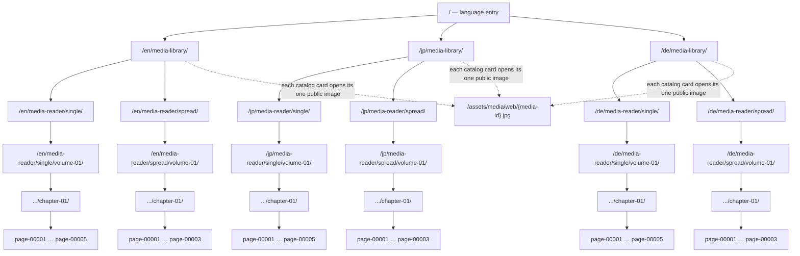

# Media Library Repair and Route Map — 2026-11-07

## Scope and status

- Mode: MAINTENANCE.
- Target: HADA Website Template Sample. Existing unrelated and prior v0.4.2 working-tree changes remain preserved.
- The implementation source is `tools/core/media_library.py`; the behavior contract is in Dev `SPEC.md` §23.6. Dev source and Sample consumer were updated. No Public Release synchronization, commit, tag, or remote deployment was performed.
- The legacy gallery is disabled in `config/gallery.yaml`. The single canonical catalog route is `/{locale}/media-library/`.

## Link map

- Each collection index links to its immediate children. Reader pages link to their parent collection through localized breadcrumbs; sequence Prev/Next links and viewer positions use manifest order.
- Single-page mode has five logical pages. Spread mode has three static pages (1+2, 3), with logical page 1 in the DOM first and visually on the configured right side.
- `/gallery/` and its detail routes are retired from the Sample output. The homepage and language entry now point to the media library.
- German has no standalone `/{locale}/index.html` homepage. Its media-reader breadcrumbs omit that nonexistent Home link while retaining all actual collection ancestors.

## Verification evidence

- Dev unit tests: `tests/test_media_library.py` — 14 passed; `tests/test_promote_build.py` — 2 passed.
- Sample candidate build: passed; five source assets validated.
- Sample real-browser UI contract: PASS; 81 HTML routes discovered in the final candidate, with no browser-contract failures or blocked requests.
- Candidate internal reference crawl: 81 HTML files; zero missing internal links/assets.
- Direct browser checks at `/jp/media-library/`: 5 cards, 5 images, all loaded, 2 immediate child routes; viewer advances 1/5 → 2/5.
- Single reader: localized ancestor breadcrumbs and “コレクションを開く” action verified.
- Spread reader: DOM order `media-item-00001`, `media-item-00002`; page 1 is visually on the right; next label is `次へ`; 390px viewport has no horizontal overflow.
- Ownership-aware promotion: PASS; 47 generated-page updates and 18 legacy gallery files were applied, then one viewer JavaScript fix was applied. No review-required paths; candidate-only `.generated/` snapshots were excluded.
- The promoted publication itself passed the browser contract (81 routes) and full internal-reference crawl (81 HTML files, 0 missing references).
- All visible viewer controls were exercised: zoom in/out, actual size, fit, fullscreen enter/exit, Escape close, and focus return. Fullscreen now targets the viewer shell because browsers reject a `<dialog>` element as the fullscreen target.
- Live local XAMPP host: `/`, `/jp/media-library/`, both reader routes, and viewer JavaScript returned HTTP 200; the catalog had five triggers and five thumbnail images; fullscreen enter/exit and close worked through the XAMPP host; retired `/jp/gallery/` returned HTTP 404.

## Limitations

- This report records an isolated candidate and local publication promotion. It does not claim Public Release parity or deployment to an external/production host.
- No XAMPP configuration was changed or Apache restarted. The running local XAMPP host served the promoted Sample publication.